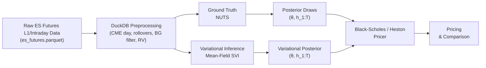

# Realized Stochastic Volatility (RSV) Pipeline: NUTS vs. Pure-JAX VI

A quantitative modeling and Bayesian inference project comparing (asymptotically) exact NUTS MCMC against Stochastic Variational Inference on a Realized Stochastic Volatility (RSV) model on 1-minute Open-High-Low-Close-Volume CME E-mini S&P 500 (`ES`) futures data.

---

## Core Research Question

Mean-field Variational Inference (VI) trades asymptotic exactness for speed, often underestimating posterior variance and dropping parameter correlations (e.g., persistence vs. vol-of-vol, or return–volatility leverage). How does this error distort tail-risk pricing?**

---

## Overview



---

## Roadmap

### 0. Market Data Engineering (`DuckDB` + `pandas_market_calendars`)
Transform 1m OHLCV intraday `ES` futures data into clean daily return and realized variance series:
- **CME Session Alignment**: Localize timestamps to `America/Chicago` and roll trading dates at 17:00 CT.
- **Calendar Hygiene**: Filter CME Globex Equity holidays and early-close sessions, exclude irrelevant options (calendar spreads), identify and handle quarterly contract rollovers.
- **Microstructure Cleaning**: Apply rolling median/MAD (Brownlees–Gallo style) outlier filtering on non-aggregated data before coarse-graining.
- **Feature Construction**: Compute daily log-returns $r_t$ and intraday realized volatility/variance measures $\mathrm{RV}_t$.

### 1. Ground Truth
- Create a Realized Stochastic Volatility (RSV) model linking daily returns $r_t$, realized volatility $\log \mathrm{RV}_t$, and latent log-volatility states $h_t$.
- Run the No-U-Turn Sampler (NUTS) on the preprocessed data.
- Obtain the benchmark joint posterior over latent volatility trajectories $h_{1:T}$ and structural parameters $\theta$.

### 2. SVI 
- Write a Stochastic Variational Inference (SVI) engine from scratch in raw JAX.
- Define a mean-field Gaussian guide $q_\phi(z)$ over unconstrained structural parameters and latent volatility states.
- Implement the Evidence Lower Bound (ELBO) explicitly:
  $$\mathcal{L}(\phi) = \mathbb{E}_{q_\phi(z)}\!\left[\log p(x, z) - \log q_\phi(z)\right]$$
- Compute reparameterized gradients and optimize variational parameters.

### 3. Evaluation
- Extract posterior parameter samples from both samplers.
- Plug both sets of posterior parameters into Black-Scholes and/or Heston.
- Compare:
  - Posterior mean vs. credible intervals of the price (tail-hedge cost).
  - Structural parameter bias and variance shrinkage under mean-field VI.
  - Latent volatility path tracking and wall-clock compute tradeoffs.

---

## Project Status

- [x] Reproducible Nix + `uv` development environment (`flake.nix`, `requirements.txt`)
- [ ] DuckDB L1 preprocessing pipeline (`sql_parse.ipynb` — CME day alignment, rollover detection, MAD filtering, and early-close lookup in progress)
- [ ] Realized Stochastic Volatility model + NUTS sampler
- [ ] Pure-JAX mean-field SVI loop
- [ ] Black-Scholes / Heston pricer & NUTS vs. VI comparison report

---

## Repository Structure

```text
.
├── flake.nix          # Nix devShell (JAX, BlackJAX, Flax, DuckDB, uv, pandas, matplotlib)
├── flake.lock         # Pinned nixpkgs lockfile
├── .envrc             # direnv integration (`use flake`)
├── requirements.txt   # Non-nixpkgs Python dependencies (pandas_market_calendars)
└── sql_parse.ipynb    # DuckDB SQL + Python market data preprocessing notebook
```

---

## Development Setup

This project uses a **Nix Flake** paired with **`uv`** for reproducible Python and DuckDB tooling.

### Prerequisites
- [Nix](https://nixos.org/) with flakes enabled
- Optional: [direnv](https://direnv.net/) (auto-activates via `.envrc`)

### Quickstart

```bash
# Enter the Nix development shell (creates .venv and syncs requirements.txt via uv)
nix develop
```

If using `direnv`:

```bash
direnv allow
```

> **Note:** `optax` will be added to the environment (`flake.nix` / `requirements.txt`) for Stage 2 (Pure-JAX SVI).
